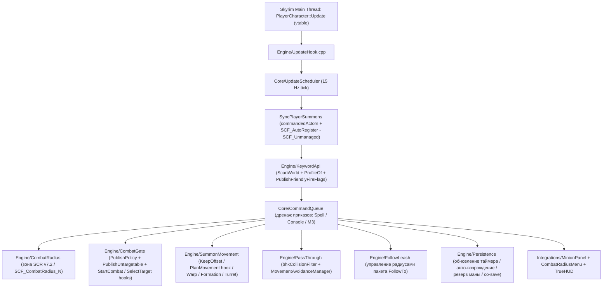

# Карта проекта Summon Control Framework (`PROJECT_MAP.md`)

Этот документ описывает полную структуру репозитория **Summon Control Framework (SCF)**: архитектурные слои, поток данных за один игровой тик и ответственность каждого файла.

---

## 1. Архитектурные слои и границы

Проект построен по принципу строгого разделения **чистой логики предметной области** и **адаптеров Creation Engine / SKSE**:

| Слой | Каталог | Зависимости | Назначение |
|---|---|---|---|
| **Core** | `src/Core/` | Только стандартная библиотека C++23 | Чистые модели, FSM, правила боя/движения/коллизий/персистентности/Keyword API. Компилируется в автономный `scf_tests.exe` без Skyrim. |
| **AI** | `src/AI/` | Только `Core/` + C++23 | Тактический скоринг целей (`TargetSelector`) и распределение боевых слотов отряда (`SquadCoordinator`). |
| **Collision** | `src/Collision/` | Только `Core/` + C++23 | Матрица классификации физических коллизий (`CollisionPairClassifier`). |
| **FriendlyFire** | `src/FriendlyFire/` | `Core/` + CommonLibSSE-NG (хуки) | Классификация отношений (`RelationshipClassifier`, чистый C++) + движковые хуки защиты от дружественного огня и сквозного пролёта снарядов/магии/оружия. |
| **Engine** | `src/Engine/` | `Core/`, `AI/`, `Collision/`, CommonLibSSE-NG | Главный тик (`UpdateHook`) и все хуки/адаптеры Creation Engine (бой, движение, коллизии, лимит, персистентность, кейворды, заклинания приказов). |
| **Integrations** | `src/Integrations/` | `Core/`, `Engine/`, `FriendlyFire/`, внешние API | Опциональные интеграции с `Precision`, `FLICK/FUCK`, `TrueHUD`, `SKSE Menu Framework` и `Papyrus VM`. |
| **Plugin** | `src/Plugin/` + `src/main.cpp` | Все слои + SKSE64 | Точка входа SKSE, проверка версии игры (`RuntimeGate`), жизненный цикл (`Messaging`) и консольные команды (`scf`). |

---

## 2. Главный поток выполнения (игровой тик)

---

## 3. Точка входа и обвязка плагина (`src/`, `src/Plugin/`)

| Файл | Ответственность |
|---|---|
| `src/PCH.h` | Прекомпилированный заголовок (CommonLibSSE-NG `RE/Skyrim.h`, `SKSE/SKSE.h`, `spdlog`, стандартные заголовки). |
| `src/main.cpp` | `SKSEPluginLoad`: настройка `spdlog`, проверка версии через `RuntimeGate`, аллокация SKSE-трамплина (1024 Б), регистрация `Messaging`, `Papyrus`, `Precision`, `FLICK` и `CombatRadiusMenu`. |
| `src/Plugin/RuntimeGate.h/.cpp` | Валидация рантайма (SE 1.5.97 / AE 1.6.x), логирование версии исполняемого файла и Address Library. |
| `src/Plugin/Messaging.h/.cpp` | Обработка событий SKSE (`kDataLoaded`, `kPostLoad`, `kNewGame`, `kPreLoadGame`, `kPostLoadGame`, `kSaveGame`): загрузка INI, установка всех хуков, резолв кейвордов, автовыдача заклинаний приказов, сброс состояния между сохранениями. |
| `src/Plugin/ConsoleCommands.h/.cpp` | Консольная команда `scf` (и алиас `sfc`): `status`, `registry`, `reload`, `order <return|follow|guard|moveto|passive|defensive|aggressive|focus>`, `help`. |

---

## 4. Чистое ядро предметной области (`src/Core/`)

Не содержит заголовков `RE/` или `SKSE/`. Полностью покрыто автономными юнит-тестами (`scf_tests.exe`).

| Файл | Ответственность |
|---|---|
| `src/Core/EntityID.h` | Детерминированный идентификатор актёра (`uint32_t`, `InvalidEntityID = 0`) вместо сырых указателей `RE::Actor*`. |
| `src/Core/Types.h` | Базовые перечисления и структуры: `Vec3`, `AggressionMode`, `SummonOrder`, `SummonState`, `CommandPriority`, `CommandType`, `TargetType`, `SquadRole`. |
| `src/Core/SummonModel.h` | Доменная модель состояния одного призыва: приказ, агрессия, FSM-состояние, фокус-цель, позиция, таймеры анти-дребезга и возврата. |
| `src/Core/SummonRegistry.h/.cpp` | Реестр активных/приостановленных/мёртвых призывов, учёт лимита по владельцу, вытеснение старейшего, `explicitRegistration` (Papyrus / `SCF_AutoRegister`), `freeSlot` (`SCF_FreeSlot`), grace-период очистки. |
| `src/Core/StateMachine.h/.cpp` | Gameplay FSM (`Idle`, `FollowOwner`, `Guard`, `AcquireTarget`, `Approach`, `Engage`, `Recover`, `Retreat`, `Return`, `Despawn`), анти-дребезг `targetLostDebounceTime`, разрыв поводка `Leash Break`. |
| `src/Core/CommandQueue.h/.cpp` | Приоритетная очередь приказов (`ManualOverride > Tactical > AutoAI`), защита от перебивания явного приказа автоматикой, TTL и применение к `SummonModel`. |
| `src/Core/FrameworkContext.h/.cpp` | Единый фасад ядра (`Settings`, `SummonRegistry`, `StateMachine`, `CommandQueue`, `UpdateScheduler`, `EventDispatcher`, `SquadCoordinator`, `TargetSelector`). |
| `src/Core/Settings.h/.cpp` | Конфигурация SCF (`SummonControlFramework.ini`): чтение/запись INI, санитизация параметров, настройки движения, боя, восстановления, коллизий, заклинаний, персистентности, лимита, Friendly Fire и HUD. |
| `src/Core/UpdateScheduler.h/.cpp` | Планировщик тактических тиков (15 Гц по умолчанию), защита от дрейфа и burst-накопления при просадках FPS. |
| `src/Core/EventDispatcher.h/.cpp` | Внутренняя шина диагностических событий ядра (переходы FSM, команды, слоты, коллизии) для логгера и тестов. |
| `src/Core/DecisionContext.h` | Снимок боевой обстановки для чистого принятия решений FSM и `TargetSelector`. |
| `src/Core/StealthContext.h` | Чистый контекст скрытности игрока и правила подавления атак при скрытности. |
| `src/Core/CombatPolicy.h/.cpp` | Чистые правила `DeriveCombatPolicy`: разрешён ли бой, ограничение на фокус-цель, `ShouldBreakCombat`, обход `fAggressionRadius`. |
| `src/Core/CombatRadius.h/.cpp` | Чистая логика встроенного Summon Combat Radius (SCR v7.2): чтение/запись `SummonCombatRadius.ini`, выбор ближайшей цели в радиусе `R`, удержание текущей цели до `R + 75`, парковка, кулдауны. |
| `src/Core/TargetPin.h/.cpp` | Чистые правила выбора цели для `CombatTargetSelector::SelectTarget` (`ChooseSelectorAnswer`, `ChooseRadiusSelectorAnswer`) при пине фокуса и зоне SCR. |
| `src/Core/Assist.h/.cpp` | Правила «бей того, кого бью я» (`ShouldAssistPlayerHit`) и проверки радиуса агрессии (`IsWithinAggressionRadius`). |
| `src/Core/WolfManeuver.h` | Чистые правила блокировки кружения/отступления для волков (`ShouldBlockWolfManeuver`) и при `SCF_NoCircling`. |
| `src/Core/Formation.h/.cpp` | Расчёт слотов строя вокруг владельца (Default + сектора `Front` / `Flank` / `Back`), поворота на направление движения и учёта индивидуальной дистанции следования. |
| `src/Core/MovementIntent.h/.cpp` | Матрица намерений движения (`KeepOffset` / `MoveTo` / `AttackApproach` / `HoldPosition` / `None`), условия завершения `Return -> Follow`, правила стационарных турелей и коррекция поворота `AdjustKeepOffsetPlanFacing`. |
| `src/Core/CatchUp.h/.cpp` | Чистые правила аварийного телепорта (warp) при отставании или застревании и отпуска поводка (`IsSummonFollowPackageShape`). |
| `src/Core/PassThrough.h/.cpp` | Чистая матрица правил сквозного прохода (`ShouldPassThrough`) для пар игрок↔призыв, призыв↔призыв и кейвордов `SCF_PassThroughFriends` / `SCF_PassThroughAll`. |
| `src/Core/CommandSpells.h/.cpp` | Чистая валидация каста 3 заклинаний приказов (`SCF_CmdHoldPosition`, `SCF_CmdFollow`, `SCF_CmdAttackTarget`). |
| `src/Core/CommandActions.h/.cpp` | Каталог M3-командных способностей по типу призыва (`SummonControlFramework_Commands.ini`) и чистая диспетчеризация `Rush` / `Detonate` / `Spell`. |
| `src/Core/Persistence.h/.cpp` | Чистая модель постоянных призывов (M4): состояния слотов (`Alive`, `Dead`, `Reviving`), авто-возрождение с таймером, резервирование макс. маны, сериализация снимка для co-save. |
| `src/Core/SummonLimit.h/.cpp` | Чистые правила лимита армии призывов (M5): суммирование базового лимита движка + бонуса SCF, режим `bUnlimitedSummons`, `freeSlot`. |
| `src/Core/MinionPanelModel.h/.cpp` | Модель представления панели миньонов (M6): агрегация строк, статусов, HP, длительности и таймера возрождения. |
| `src/Core/AttackTrace.h` | Чистые структуры и классификатор трассировки траектории призыва от приказа «В атаку» до первого удара (`[AttackTrace]`). |
| `src/Core/ConsoleHandler.h/.cpp` | Чистый парсер консольных аргументов `scf` / `sfc` без зависимости от консоли движка. |
| `src/Core/KeywordApi.h/.cpp` | **Ядро Keyword API v2:** 64-битная маска флагов (36 флагов + 10 алиасов), парсер 4 числовых префиксов (`SCF_CombatRadius_<N>`, `SCF_Leash_<N>`, `SCF_FollowDist_<N>`, `SCF_SpeedMult_<N>`), резолверы угрозы, специализаций, строя, фильтрации приказов, скрытности, FF и персистентности. |

---

## 5. Тактический ИИ и классификация коллизий (`src/AI/`, `src/Collision/`)

| Файл | Ответственность |
|---|---|
| `src/AI/TargetSelector.h/.cpp` | Двухфазный скоринг кандидатов (квалификация + веса: угроза владельцу, дистанция, роль, sticky-бонус текущей цели, режимы `Passive`/`Defensive`/`Aggressive`/`FocusTarget`). |
| `src/AI/SquadCoordinator.h/.cpp` | Координация отряда из 2+ призывов: лимит одновременно атакующих одну цель (`maxAttackersPerTarget`), распределение ролей и перераспределение целей. |
| `src/Collision/CollisionPairClassifier.h/.cpp` | Чистый классификатор пар физических коллизий: пропускает пары `Player ↔ OwnSummon` и `Summon ↔ Summon`, никогда не трогает стены, землю, врагов и ragdoll. |

---

## 6. Защита от дружественного огня (`src/FriendlyFire/`)

| Файл | Ответственность |
|---|---|
| `src/FriendlyFire/FriendlyFireSettings.h` | Структура настроек `[FriendlyFire]` (раздельные флаги `bBlock*Damage` и `b*PassThrough`, союзники, крики, AoE). |
| `src/FriendlyFire/RelationshipClassifier.h/.cpp` | Чистый классификатор источника атаки (`Player`, `PlayerAlly`, `PlayerOwnedSummon`, `AlliedSummon`, `Neutral`, `Hostile`, `Unknown`) с защитой от циклов в цепочке владельцев (`MaxCommandChainDepth = 4`) и fail-safe (враги/неизвестные никогда не блокируются). |
| `src/FriendlyFire/ProtectionQuery.h` | Общий движковый мост для всех FF-хуков: собирает контекст атакующего/цели, проверяет реестр и потокобезопасные флаги `SCF_FriendlyFireProtected` / `SCF_AllowFriendlyFire`, вызывает `RelationshipClassifier`. |
| `src/FriendlyFire/HitHook.h/.cpp` | Хук `Actor::ProcessHit` (ID 37673): обнуление дружественного урона, подавление стаггера, отталкивания и враждебности (Damage Protection). |
| `src/FriendlyFire/MagicHook.h/.cpp` | Vtable-хук `RE::VTABLE_Character[4]` слот `1` (`Actor::AddTarget`, SE ID 37832): блокировка враждебных заклинаний, концентрации, криков, зачарований и AoE-взрывов (фаерболы) по защищённым целям. |
| `src/FriendlyFire/ProjectileHook.h/.cpp` | Vtable-хуки `ArrowProjectile` и `MissileProjectile` (`AddImpact` / `HandleHits`): сквозной пролёт стрел, болтов и магических снарядов сквозь призывов без детонации. |
| `src/FriendlyFire/HitReactionHook.h/.cpp` | Подавление анимаций стаггера и боевых реакций при заблокированном дружественном ударе. |
| `src/FriendlyFire/KillmoveHook.h/.cpp` | Запрет запуска добиваний (killmove) игрока по собственным/защищённым призывам. |

---

## 7. Адаптеры и хуки Creation Engine (`src/Engine/`)

| Файл | Ответственность |
|---|---|
| `src/Engine/UpdateHook.h/.cpp` | Vtable-хук `PlayerCharacter::Update`: оркестратор главного тика (синхронизация `commandedActors`, `SCF_AutoRegister`/`SCF_Unmanaged`, `KeywordApi`, очередь приказов, `CombatRadius`, `CombatGate`, `SummonMovement`, `PassThrough`, `Persistence`, `MinionPanel`). |
| `src/Engine/EventAdapter.h/.cpp` | Подписки на события движка: `TESActiveEffectApplyRemoveEvent`, `TESDeathEvent`, `TESCellAttachDetachEvent`, `TESHitEvent` (триггер M2 Assist и фиксация попаданий `[AttackTrace]`). |
| `src/Engine/CombatGate.h/.cpp` | Полный контроль боя: патч 10 call-site `Actor::StartCombat`, `Actor::CanAttackActor`, vtable-хуки `CombatTargetSelector{Standard,Fixed}::SelectTarget` (пин фокуса, зона SCR, угроза `SCF_Untargetable`/`HighThreat`/`LowThreat`, специализации `SCF_Bodyguard`/`FinishLowHP`/`HuntCasters`/`HuntRanged`), нативные биты `kAttackingDisabled|kCastingDisabled`, `BreakCombat`. |
| `src/Engine/CombatRadius.h/.cpp` | Движковый адаптер Summon Combat Radius (SCR v7.2): загрузка `SummonCombatRadius.ini`, резолв радиуса (в т.ч. `SCF_CombatRadius_<N>`), публикация врагов, выбор и удержание цели, парковка. |
| `src/Engine/SummonMovement.h/.cpp` | Исполнение движения: `KeepOffsetFromActor` / `ClearKeepOffsetFromActor`, `SetDontMove`, vtable-хук `MovementPlannerAgentKeepOffset::PlanMovement` (исправление поворота корпуса), аварийный catch-up warp, сектора строя, стационарные турели, множитель скорости `SCF_SpeedMult_<N>`. |
| `src/Engine/FollowLeash.h/.cpp` | Отпуск ванильного поводка `FollowTo` на время `MoveTo`/`Attack`/`WaitGuard` (SE seat создания пакета `id 36410 + 0x84` + shape-распознавание fallback) и восстановление GMST при `Follow`/`Return`. |
| `src/Engine/PassThrough.h/.cpp` | Сквозной проход тел и навигации: хуки `bhkCollisionFilter::IsCollisionEnabled` и `MovementAvoidanceManager::ShouldAvoid`, потокобезопасная публикация групп и флагов `SCF_PassThroughFriends` / `SCF_PassThroughAll`. |
| `src/Engine/WolfManeuver.h/.cpp` | Блокировка тактического кружения/отступления (`Circle`, `Flank`, `Surround`, `Fallback` и т.д.) для сфокусированных волков и призывов с `SCF_NoCircling`. |
| `src/Engine/KeywordApi.h/.cpp` | Zero-Master резолвер `KYWD` на `kDataLoaded` (все 36 флагов + 10 алиасов + сканер `SCF_CombatRadius_/Leash_/FollowDist_/SpeedMult_<N>`), `ScanWorld`, `ProfileOf` (`NPC_`/`RACE`/активный `MGEF`/исходный `MGEF`), потокобезопасная таблица `FriendlyFireFlags`. |
| `src/Engine/CommandSpells.h/.cpp` | Подписки `TESSpellCastEvent` и `TESMagicEffectApplyEvent` для 3 заклинаний приказов (`SCF_CmdHoldPosition`, `SCF_CmdFollow`, `SCF_CmdAttackTarget`), автовыдача игроку и ручное управление из FLICK. |
| `src/Engine/CommandActions.h/.cpp` | Исполнение M3-командных способностей (`Rush`, `Detonate`, кастомные `SPELL` из INI и кейворды `SCF_CmdRush` / `SCF_CmdDetonate`). |
| `src/Engine/Persistence.h/.cpp` | Постоянные призывы (M4): продление `ActiveEffect`, авто-возрождение через `CastSpellImmediate`, резерв макс. маны, SKSE co-save (`Save`/`Load`/`Revert`) и учёт `SCF_Persistent` / `SCF_NoPersistence`. |
| `src/Engine/SummonLimit.h/.cpp` | Лимит армии призывов (M5): хук подсчёта слотов движка, поддержка `bUnlimitedSummons`, бонуса лимита и `SCF_FreeSlot`. |
| `src/Engine/InputHandler.h/.cpp` | Обработка клавиши переключения панели миньонов (`uMinionPanelToggleKey`) и HUD-уведомлений. |
| `src/Engine/AttackTrace.h/.cpp` | Сбор и печать трассировки `[AttackTrace]` от попадания `SCF_CmdAttackTarget` до первого удара призыва. |
| `src/Engine/ActorSpace.h` | Единая проверка «в одном загруженном пространстве» (`ShareLoadedSpace`) для соседних внешних ячеек одного worldspace. |

---

## 8. Внешние интеграции и UI (`src/Integrations/`, `src/third_party/`)

| Файл | Ответственность |
|---|---|
| `src/Integrations/PrecisionBackend.h/.cpp` | Интеграция с `Precision.dll` (v2.0.4+): `PreHitCallback` возвращает `bIgnoreHit = true` для физического сквозного пролёта оружия ближнего боя сквозь защищённых призывов без хитстопа. |
| `src/Integrations/PrecisionAPI.h` | Заголовок публичного API Precision. |
| `src/Integrations/FlickMenu.h/.cpp` | Интерактивное меню настроек SCF внутри `FUCK.dll` (клавиша F7, категория `Gameplay`): заклинания приказов, тайминги, Friendly Fire, коллизии, персистентность, лимит, мгновенное сохранение в INI. |
| `src/Integrations/MinionPanel.h/.cpp` | Оверлей-панель миньонов (M6) на базе `FUCK.dll`: список живых и возрождающихся призывов, HP, длительность, статус, метки `[Scripted]`. |
| `src/Integrations/CombatRadiusMenu.h/.cpp` | Панели **Summon Combat Radius → Status / Settings** в опциональном `SKSE Menu Framework` с перезагрузкой INI и живым статусом. |
| `src/Integrations/TrueHUDBackend.h/.cpp` | Опциональная интеграция с `TrueHUD` (индикаторы/инфобары). |
| `src/Integrations/Papyrus.h/.cpp` | Регистрация 5 нативных функций класса `SCF` в Papyrus VM (`RegisterSummon`, `UnregisterSummon`, `IsRegistered`, `GetSummons`, `GetSummonCount`). |
| `src/third_party/fuck/` | Заголовки `FUCK_API.h` и `IconsFontAwesome6.h` для FLICK/MinionPanel. |
| `src/third_party/imgui/` | Заголовки `imgui.h` и `imconfig.h` для интерфейса меню. |
| `src/third_party/TrueHUDAPI.h` | Заголовок API TrueHUD. |

---

## 9. Скрипты, данные, утилиты, тесты и документация

| Путь | Назначение |
|---|---|
| `data/SummonControlFramework.esp` | ESL-плагин с 3 заклинаниями приказов (`SCF_CmdHoldPosition`, `SCF_CmdFollow`, `SCF_CmdAttackTarget`) и базовыми кейвордами `aaMZkw_SummonCombatArea{200,500,1000}`. |
| `scripts/Source/SCF.psc` | Публичный Papyrus-контракт для мододелов (компиляция сторонних скриптов против `SCF`). |
| `tools/make_command_spells_esp.py` | Генератор `data/SummonControlFramework.esp` из `Skyrim.esm`. |
| `tools/make_keyword_test_esp.py` | Генератор тестового ESL-плагина `SCF_KeywordApiTest.esp` со всеми 40 кейвордами Keyword API v2 и тестовыми заклинаниями. |
| `tools/scene/` | Консольные `bat`-скрипты (`scf_scene.txt`, `scf_enemies.txt`, `scf_reset.txt`) и инструкция `README.md` для воспроизводимой тестовой сцены в игре. |
| `tests/` | Автономный набор юнит-тестов (`scf_tests.exe`, 266 тестов, нулевые внешние зависимости через `tests/check.h`). |
| `docs/PLAN.md` | Дорожная карта, этапы и статусы разработки. |
| `docs/ARCHITECTURE.md` | Подробная техническая архитектура, адреса/ID хуков, контракты и ограничения. |
| `docs/PROJECT_MAP.md` | Этот файл — навигационная карта модулей и файлов проекта. |
| `docs/KEYWORDS.md` | Полный справочник Zero-Master Keyword API v2 для авторов модов и патчей (KID/SPID/xEdit). |
| `docs/STATUS.md` | Текущий снимок состояния проекта: что собрано/покрыто автотестами vs что проверено в игре. |
| `docs/TESTING.md` | Стратегия тестирования, команды сборки/запуска и полевые ручные тест-кейсы. |
| `docs/JOURNAL.md` | Хронологический инженерный журнал расследований, решений и проверок. |
| `xmake.lua` | Сборка плагина `SummonControlFramework.dll` (SE + AE) и тестов `scf_tests.exe`. |
| `README.md` | Обзор возможностей, установка, быстрый старт, сборка и матрица зависимостей. |
| `AGENTS.md` | Инженерные стандарты и регламент ведения документации. |
